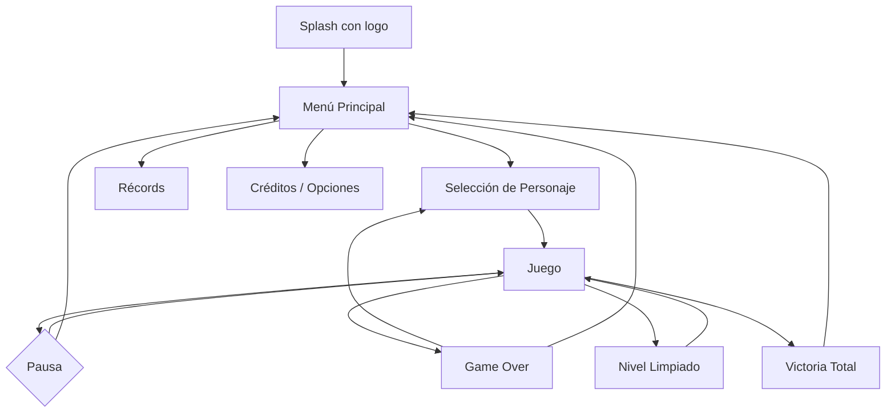

# Documento de Requisitos de Producto (PRD)
## Juego Limón Chancludo

> **Versión:** 1.0
> **Fecha:** Noviembre 2026
> **Estado:** Borrador Inicial (aprobado)
> **Plataforma:** Android (Jetpack Compose, Kotlin)
> **Nombre técnico:** `mx.udg.limonchancludo`
> **Nombre visible en UI:** Limón Chancludo

---

## 1. Visión del Producto y Objetivos

**Limón Chancludo** es un juego arcade tipo laberinto (estilo Pac-Man) en el que el jugador controla un **mono pixelado** que debe comerse todos los **limones** de un tablero mientras es perseguido por **sandalias** (chinchorros) vivientes. Al comérselos con el limón de poder, el mono se vuelve temporalmente el cazador.

Es una aplicación original: **ningún sprite, nombre, nivel o código proviene de Pac-Man**. Todo el arte es pixel art generado por código dentro de la app.

### Objetivos Clave
- **Diversión arcade inmediata:** una partida de 1–3 minutos, reinicio rápido, difícil de soltar.
- **Arte pixelado 100% por código:** sprites definidos como matrices de píxeles y dibujados con `Canvas` (sin assets externos, sin problemas de derechos de autor).
- **Personalización:** 6 monos seleccionables (desbloqueables) con estética propia.
- **Progresión:** múltiples niveles con dificultad creciente, récords locales y desbloqueos.
- **Estética retro:** paleta de colores arcade, fuente pixelada, animaciones y sonidos chiptune.

---

## 2. Perfil de Usuario y Casos de Uso

| Tipo de Usuario | Descripción | Necesidad Principal |
| :--- | :--- | :--- |
| **Jugador casual** | Juega en el metro o en ratos libres, busca algo rápido y colorido. | Partidas cortas, controles simples (swipe), reinicio en un toque. |
| **Jugador arcade** | Busca reta, combos, puntuaciones altas y dominar la IA. | Récords locales, desbloqueos por puntaje, niveles difíciles. |
| **Niños / familias** | Público general que disfruta personajes tiernos y colores vivos. | Personajes variados, sin violencia, sin compras dentro de la app. |

### Casos de uso principales
- **CU-01:** El usuario abre la app, elige un mono en el menú de selección y empieza a jugar.
- **CU-02:** El usuario se mueve con swipe o D-pad, come limones, gana puntos y limpia el nivel.
- **CU-03:** El usuario agarra el limón de poder, las sandalias huyen y las caza por puntos extra.
- **CU-04:** El usuario pierde sus 3 vidas, ve el Game Over con su puntaje y su récord, y reintenta.
- **CU-05:** El usuario desbloquea un nuevo mono al alcanzar un puntaje objetivo.
- **CU-06:** El usuario consulta su top de récords y los créditos.

---

## 3. Concepto de Juego y Reglas

### 3.1 Loop de juego
1. El mono aparece en el punto de partida del laberinto.
2. Come **limones** repartidos en las celdas del tablero.
3. Las **sandalias** lo persiguen por el laberinto.
4. Al comerse **todos los limones**, el nivel se limpia y avanza al siguiente (más difícil).
5. Si una sandalia lo toca, pierde una vida; al perder las 3, termina la partida.

### 3.2 Reglas de movimiento
- Movimiento por casillas del grid con suavizado entre celdas (velocidad constante en tiles/segundo).
- El giro se encola: si el jugador gira antes de llegar a la casilla, el giro se aplica en el siguiente cruce.
- No se pueden atravesar paredes; los túneles laterales envuelven el tablero horizontalmente.

### 3.3 Puntuación

| Acción | Puntos |
| :--- | :--- |
| Comer un limón | 10 |
| Comer el limón de poder (Limón Chancludo) | 50 |
| Cazar una sandía asustada (1ª / 2ª / 3ª / 4ª seguidas) | 200 / 400 / 800 / 1600 |
| Limpiar un nivel (bonus) | 100 + nivel × 50 |
| Bonus de vida extra | cada 10 000 puntos |

### 3.4 Vidas y dificultad
- **3 vidas** por partida (muestra de vidas como iconos de mono).
- Las sandalias se aceleran y su IA mejora con cada nivel.
- El mono nunca pierde velocidad; solo cambia la agresividad de los enemigos.

### 3.5 Limón de poder
- 4 limones de poder (más grandes, con "chispas") en los 4 extremos del tablero.
- Al comerlo: **8 segundos** en modo *Chancludo*.
  - Las sandalias se vuelven **azules/asustadas**, huyen del mono y parpadean.
  - Cada sandalia cazada vuelve a la casa y revive tras unos segundos.
  - El temporizador se muestra en la barra superior.

### 3.6 Condiciones de fin de partida
- **Derrota:** 0 vidas → pantalla de Game Over con puntaje, récord y opción de reintentar/menú.
- **Victoria de nivel:** todos los limones comidos → pantalla "Nivel Limpiado" con bonus.
- **Victoria total:** nivel 8 superado → pantalla final con resumen y agradecimientos.

---

## 4. Personajes (6 monos seleccionables)

Todos son **cosméticos** (no alteran velocidad ni hitbox): 16×16 px, animación de 4 frames al caminar.

| # | Personaje | Descripción visual | Desbloqueo |
| :--- | :--- | :--- | :--- |
| 1 | **Mono Clásico** | Mono marrón con cara de curiosidad. | Inicial |
| 2 | **Mono Ninja** | Mono con cinta roja y máscara negra. | 5 000 pts |
| 3 | **Mono Pirata** | Mono con parche y sombrero de pirata. | 10 000 pts |
| 4 | **Mono Astronauta** | Mono con casco y traje espacial blanco. | 20 000 pts |
| 5 | **Mono Chef** | Mono con gorro blanco de cocina. | 35 000 pts |
| 6 | **Mono Robot** | Mono metálico con antena y ojos LED. | 50 000 pts |

- El personaje elegido y sus desbloqueos se guardan localmente (DataStore).
- Los personajes bloqueados se muestran en gris con el requisito de puntaje.

---

## 5. Enemigos (4 sandalias)

| # | Sandía | Personalidad IA | Color | Comportamiento |
| :--- | :--- | :--- | :--- | :--- |
| 1 | **La Perseguidora** | Siempre va por ti | Rosa | Dirige su vector hacia la celda del mono. |
| 2 | **La Emboscadora** | Calcula dónde irás | Cian | Apunta a la celda 4 tiles adelante del mono. |
| 3 | **La Patrullera** | Vigila su sector | Naranja | Patrulla las esquinas y solo persigue si estás cerca. |
| 4 | **La Errátil** | Impredecible | Roja | Se mueve al azar salvo cuando estás muy cerca. |

- Todas comparten: fase **Esparcir** (ronda 1, a sus esquinas) → fase **Persecución** (ciclos de 20 s / 8 s según nivel).
- **Modo asustada:** al comer el Limón Chancludo todas huyen; si las tocas, se las come y vuelven a la casa.
- Reglas clásicas de IA: no se pueden dar la vuelta 180°, deciden en cada cruce.

---

## 6. Pantallas y Navegación

### Descripción de pantallas
1. **Splash:** logo pixelado "LIMÓN CHANCLU DO" animado + carga.
2. **Menú Principal:** título grande, botones: *Jugar*, *Personajes*, *Récords*, *Opciones*, *Créditos*; personaje activo en el centro.
3. **Selección de Personaje:** carrusel/grid de los 6 monos con nombre, vista previa animada y requisito de desbloqueo.
4. **Juego:** tablero, HUD (puntaje, récord, nivel, vidas, temporizador de poder), controles.
5. **Pausa:** overlay con *Continuar*, *Reiniciar*, *Menú*.
6. **Nivel Limpiado:** bonus, puntaje acumulado, botón *Siguiente nivel*.
7. **Game Over:** puntaje, récord, mono caído, *Reintentar* / *Menú*.
8. **Victoria Total:** resumen de la partida, agradecimiento y botón al menú.
9. **Récords:** top 5 local por personaje y global.
10. **Opciones:** sonido on/off, vibración, controles (swipe/D-pad), modo de letra.
11. **Créditos:** autoría, versión, nota de arte original por código.

---

## 7. Controles

| Entrada | Acción |
| :--- | :--- |
| **Swipe** (recomendado) | Mover arriba/abajo/izquierda/derecha; el giro se encola. |
| **D-pad virtual** | 4 botones en pantalla (alternativa para tabletas). |
| **Botón central HUD** | Pausa. |
| **Teclado / gamepad** (opcional) | Flechas o WASD; *Esc/Pause* para pausar. |

- Los controles se pueden cambiar en Opciones (swipe, D-pad o ambos).
- Feedback háptico leve al comer limón de poder y al morir (opcional).

---

## 8. Estilo Visual y Audio

### 8.1 Dirección artística
- **Resolución lógica:** 21×23 tiles; el tablero se escala con **nearest-neighbor** (píxeles nítidos, sin difuminado).
- **Paleta arcade:** fondo azul noche `#0B0B2A`, paredes azul neón, limones amarillo `#FFE93B`, sandalias de colores saturados.
- **Fuente:** tipografía pixelada embebida (o fuente monoespaciada en negrita) para HUD y menús.
- **Animaciones:** mono (4 frames caminar, 2 muerte), sandalias (4 frames al asustarse), parpadeo del modo asustado, limones con brillo.
- **Efectos:** destellos al comer, números flotantes de puntos, explosión pixelada al morir.

### 8.2 Audio
- **Efectos (SoundPool):** *nom-nom* al comer, campana al agarre del poder, *waka* alterno, sonido de muerte, jingle de nivel, fanfarria de victoria.
- **Música:** loop chiptune opcional (Opciones), generada o incluida como archivo libre de derechos.
- Todo configurable y sin audio al iniciar la app en silencio (respeta modo silencio del sistema).

---

## 9. Requisitos Funcionales

### RF-01: Menú y navegación
- RN-01.1: La app inicia en Splash → Menú Principal en < 2 s.
- RN-01.2: Navegación por botones con estado visible (selección/hover).
- RN-01.3: Botón *Atrás* del sistema: en juego abre Pausa; en submenús vuelve al Menú.

### RF-02: Selección de personaje
- RN-02.1: Grid con los 6 monos, vista previa animada y nombre.
- RN-02.2: Personajes bloqueados muestran candado y puntaje requerido.
- RN-02.3: La selección se persiste y se recuerda al abrir la app.

### RF-03: Motor de juego
- RN-03.1: Tablero 21×23 cargado desde un mapa ASCII en código.
- RN-03.2: Movimiento del mono a velocidad constante, giro encolado y túneles laterales.
- RN-03.3: Colisión por celdas con paredes y con enemigos.
- RN-03.4: Bucle de juego a 60 FPS con pausa automática al perder el foco.

### RF-04: Limones y puntuación
- RN-04.1: 4 limones de poder fijos + limones normales en todas las celdas libres.
- RN-04.2: Puntaje según tabla de la sección 3.3, con números flotantes.
- RN-04.3: Conteo de limones restantes visible en HUD.

### RF-05: Enemigos
- RN-05.1: 4 sandalias con IA diferenciada (sección 5).
- RN-05.2: Fases Esparcir/Persecución con temporizador.
- RN-05.3: Modo asustado con temporizador visual y caza por puntos.

### RF-06: Vidas, niveles y flujo
- RN-06.1: 3 vidas; perder una reinicia posiciones conservando limones y puntaje.
- RN-06.2: 8 niveles con mapas propios y dificultad creciente.
- RN-06.3: Game Over, Nivel Limpiado y Victoria Total con sus pantallas.
- RN-06.4: Bonus de vida cada 10 000 puntos.

### RF-07: Persistencia
- RN-07.1: Top 5 de récords (global y por personaje) en DataStore.
- RN-07.2: Personaje elegido, sonido, vibración y tipo de control.
- RN-07.3: Desbloqueos calculados desde el mejor puntaje histórico.

### RF-08: Opciones y accesibilidad
- RN-08.1: Sonido, vibración y control conmutables.
- RN-08.2: Textos con contraste AA; sin información solo por color (parpadeo + ícono en modo poder).
- RN-08.3: Soporte TalkBack en menús (el juego es visual, pero los menús serán etiquetados).

---

## 10. Requisitos No Funcionales

1. **Rendimiento:** 60 FPS estables en dispositivos gama media; < 1% de frames perdidos; sin asignaciones de memoria por frame.
2. **Compatibilidad:** Android 8.0 (API 26) o superior; orientación vertical principal; adaptado a pantallas pequeñas y tabletas.
3. **Tamaño:** APK < 15 MB (todo el arte generado en código).
4. **Privacidad:** 100% local, sin cuentas, sin red, sin anuncios ni compras.
5. **Estabilidad:** sin crash al rotar (orientación bloqueada o estado restaurado); la partida se pausa al salir.
6. **Originalidad:** cero assets o código de terceros protegidos; nombres y arte originales.

---

## 11. Historias de Usuario

- **HU-1:** *Como jugador quiero elegir a mi mono favorito* para identificarme con el personaje.
- **HU-2:** *Como jugador quiero moverme con el pulgar sin mirar los botones* para jugar con una mano.
- **HU-3:** *Como jugador quiero ver mi récord al terminar* para motivarme a repetir.
- **HU-4:** *Como jugador quiero desbloquear personajes jugando* para tener metas a corto plazo.
- **HU-5:** *Como jugador quiero pausar y salir sin perder la partida* para poder interrumpir el juego.
- **HU-6:** *Como jugador quiero un tablero distinto en cada nivel* para que no se vuelva repetitivo.

---

## 12. Criterios de Aceptación (MVP jugable)

1. Se puede seleccionar entre 6 monos (1 inicial + 5 bloqueados por puntaje).
2. El mono se mueve suave, gira encolado y no atraviesa paredes ni se sale del túnel.
3. Se comen limones y limón de poder con su puntaje y efecto temporal.
4. Las 4 sandalias persiguen con comportamientos diferenciados y tienen modo asustado.
5. Vidas, Game Over, Nivel Limpiado y Victoria Total funcionan de punta a punta.
6. Hay al menos 3 niveles jugables con mapas distintos.
7. Récord local persiste entre sesiones y desbloquea personajes.
8. 60 FPS en emulador y en un dispositivo físico gama media.
9. Las 8 pruebas unitarias del motor pasan (`gradlew :app:testDebugUnitTest`).

---

## 13. Fuera de Alcance (v1.0)

- Multijugador en línea o local por pantallas.
- Tiendas, monedas reales, anuncios.
- Servidores, nube, cuentas (Google Play Games).
- Niveles generados por el usuario o editor de mapas.
- Idiomas distintos del español (i18n queda preparada en strings).
- Gamepad obligatorio (solo soporte opcional).

---

## 14. Métricas de Éxito

| Métrica | Objetivo |
| :--- | :--- |
| Tasa de finalización del nivel 1 | > 70% de las partidas |
| Sesiones repetidas (reintento tras Game Over) | > 50% |
| FPS promedio | ≥ 58 |
| Crash-free sessions | 100% en pruebas internas |
| Desbloqueo del 2do personaje | > 30% de jugadores |
