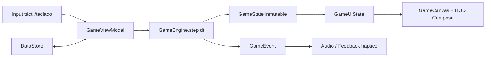

# Diseño Técnico (Technical Design) - Limón Chancludo

> **Versión:** 1.0
> **Fecha:** Noviembre 2026
> **Plataforma:** Android (Kotlin, Jetpack Compose, Canvas)
> **Paquete:** `mx.udg.limonchancludo`
> **Propósito:** Documento arquitectónico de referencia para la implementación y para agentes de IA.

---

## 1. Stack Tecnológico

| Componente | Elección | Versión (esperada) |
| :--- | :--- | :--- |
| Lenguaje | Kotlin | 2.2.x |
| UI | Jetpack Compose (BOM 2026.02.x) | Material 3 |
| Render del juego | `androidx.compose.foundation.Canvas` + `DrawScope` | — |
| Ciclo de vida | `androidx.lifecycle` + `ViewModel` | 2.11.x |
| Persistencia | `androidx.datastore:datastore-preferences` | 1.1.x |
| Audio | `android.media.SoundPool` + `MediaPlayer` (música) | API nativa |
| Tests | JUnit 4 + Compose UI Test | — |
| minSdk / targetSdk | 26 / 37 | compileSdk 37 |
| Orientación | `portrait` (bloqueada) | — |

Sin motores externos (sin libGDX/KorGE): el juego se construye sobre Compose + un motor Kotlin puro, para mantener el proyecto 100% Compose y el APK ligero.

---

## 2. Arquitectura General

Patrón **MVVM + Motor de juego puro (Game Engine)**. La capa de juego es agnóstica de Android y se puede probar con JUnit puro.

```
mx.udg.limonchancludo/
│
├── game/                      # MOTOR PURO (sin dependencias de Android)
│   ├── model/
│   │   ├── Direction.kt       # UP/DOWN/LEFT/RIGHT + deltas
│   │   ├── Tile.kt            # Enum: WALL, FLOOR, POWER_TILE, TUNNEL
│   │   ├── Maze.kt            # Grid 21x23 + túneles + spawn points
│   │   ├── MazeLayouts.kt     # 8 mapas ASCII (niveles 1..8)
│   │   ├── Character.kt       # 6 monos: id, nombre, paleta, requisito
│   │   ├── Actor.kt           # Posición en tiles + progreso + dirección
│   │   ├── Sandal.kt          # Enemy: tipo IA, estado, objetivo
│   │   ├── GameState.kt       # Estado completo inmutable (score, vidas, fase…)
│   │   └── GameEvent.kt       # Eventos de salida (comer, morir, nivel…)
│   ├── engine/
│   │   ├── GameEngine.kt      # step(dt) + handleInput() + reduce()
│   │   ├── MovementSystem.kt  # Movimiento en grid con giro encolado
│   │   ├── CollisionSystem.kt # Monito-limón, monito-sandía, paredes
│   │   ├── SandalAI.kt        # Decisión de dirección por cruce
│   │   ├── Pathing.kt         # BFS/objetivo por celda
│   │   ├── SpawnSystem.kt     # Reaparición tras morir / salir de la casa
│   │   └── ScoreSystem.kt     # Puntos, combos, bonus de vida
│   └── assets/
│       ├── PixelSprite.kt     # Matriz de píxeles + paleta → ImageBitmap
│       ├── SpriteFactory.kt   # Sprites de los 6 monos, 4 sandías, limones
│       └── Sprites.kt         # Matrices literales 16x16 en código
│
├── ui/
│   ├── state/
│   │   ├── GameUiState.kt     # Snapshot para Compose (score, vidas, modo…)
│   │   └── Screens.kt         # Enum de rutas/navegación
│   ├── GameViewModel.kt       # Expone StateFlow, input, pausa, ticks
│   ├── screens/
│   │   ├── SplashScreen.kt
│   │   ├── HomeScreen.kt
│   │   ├── CharacterSelectScreen.kt
│   │   ├── GameScreen.kt      # Canvas + HUD + controles + overlays
│   │   ├── RecordsScreen.kt
│   │   ├── OptionsScreen.kt
│   │   └── CreditsScreen.kt
│   ├── components/
│   │   ├── GameCanvas.kt      # Dibujo del tablero/actores en Canvas
│   │   ├── HudBar.kt
│   │   ├── DPad.kt
│   │   ├── SwipeArea.kt
│   │   └── PixelButton.kt     # Botón con borde pixelado
│   └── theme/
│       ├── Color.kt           # Paleta arcade
│       ├── Theme.kt
│       └── Type.kt            # Fuente pixelada
│
├── data/
│   ├── PreferencesRepository.kt  # DataStore: personaje, sonido, control
│   └── RecordsRepository.kt      # Top 5 + mejor puntaje (desbloqueos)
│
├── audio/
│   └── GameAudio.kt           # SoundPool + música opcional
│
├── MainActivity.kt
└── AndroidManifest.xml
```

### Flujo de datos



---

## 3. Modelo del Mundo

### 3.1 Tablero (grid 21×23)
- Cada celda es un `Tile`: `WALL`, `FLOOR`, `POWER` (casilla de limón de poder), `TUNNEL`.
- Los mapas se definen como **strings ASCII** (una fila por línea), lo que permite leerlos y balancearlos fácil:

```
# = muro          . = limón           o = limón de poder
_ = celda vacía   = = pared exterior   + = casa de sandías
```

Ejemplo de fila: `=====================` y `=o....#.#.#.#....o..=`

- **Spawn del mono:** celda `P` en el mapa.
- **Casa de sandías:** bloque central `+` con 4 celdas libres y una puerta `=` (las sandías salen por la puerta; el mono no puede entrar).
- **Túnel:** la fila central con `T` a ambos extremos: salir por un borde reaparece en el opuesto.

### 3.2 Actores y movimiento
- **Unidad de posición:** `col: Int, row: Int` + `progress: Float` (0f..1f entre la celda actual y la siguiente).
- **Velocidad:** `tilesPerSecond` (mono: 6.0; sandías: 5.5 + 0.25/nivel; modo asustada: 3.5).
- **Giro encolado:** `inputDirection` y `queuedDirection`; el cambio aplica solo si la celda destino es transitable y no es opuesta (salvo en modo inverso permitido).
- **Regla anti-tunel:** al cruzar el borde se ajusta `col` con módulo `width`.
- **Colisión con muro:** se verifica antes de iniciar el avance; si no es transitable, `progress` se queda en 0.

### 3.3 Colisiones
- **Mono vs limón:** misma celda y `progress > 0.5` → comer (evento).
- **Mono vs sandía:** distancia euclidiana en celdas (con progreso) < 0.6 → impacto:
  - Sandía asustada → caza (+puntos, combo), sandía vuelve a la casa.
  - Sandía normal → pierde vida, `respawn()` con invulnerabilidad de 2 s (parpadeo).

---

## 4. Bucle de Juego (Game Loop)

```kotlin
// GameViewModel.kt (esquema)
private var lastFrame by mutableLongStateOf(0L)
private var accumulator = 0f

LaunchedEffect(Unit) {
    while (isActive && !paused) {
        withFrameNanos { now ->
            val dt = ((now - lastFrame) / 1e9f).coerceAtMost(0.05f)
            lastFrame = now
            accumulator += dt
            while (accumulator >= FIXED_STEP) {          // 1/60 s
                val events = engine.step(FIXED_STEP)     // lógica determinista
                events.forEach(audio::play)             // sonidos
                accumulator -= FIXED_STEP
            }
            uiState = engine.snapshot()                 // para Compose
        }
    }
}
```

- **Paso fijo** de 1/60 s para lógica determinista + interpolación visual con `accumulator/FIXED_STEP` (movimiento suave sin importar los FPS reales).
- **Pausa:** al perder el foco (`ON_STOP`) o abrir el overlay se detiene el bucle; al volver se reinicia `lastFrame` (sin "teletransporte").
- **Dibujo:** un solo `Canvas` dibuja tablero y actores; el HUD es un `Box` fuera del Canvas para no invalidar el tablero en cada punto.

---

## 5. IA de las Sandías

### 5.1 Máquina de estados por sandía
`HOUSE (saliendo) → SCATTER → CHASE → FRIGHTENED → EATEN (regresa a casa) → HOUSE`

- **Fases globales:** ciclo `CHASE 20s / SCATTER 8s` (más persecución en niveles altos; nivel 8: 25s/4s).
- **Modo asustado:** duración `8s - 0.5s × nivel` (mínimo 4 s); parpadeo en los últimos 2 s.

### 5.2 Decisión por cruce
Al llegar al **centro** de una celda y poder girar (no está prohibido el giro 180°):
1. Calcular **celda objetivo** según tipo:
   - **Perseguidora:** celda del mono.
   - **Emboscadora:** celda del mono + 4 tiles en su dirección actual.
   - **Patrullera:** si distancia > 7 tiles → su esquina (scatter); si no → celda del mono.
   - **Errátil:** celda aleatoria renovada cada 4 s; si distancia < 5 tiles → celda del mono.
   - **Asustada:** celda aleatoria (huye del mono por distancia negativa en BFS).
   - **EATEN:** puerta de la casa.
2. Entre las direcciones permitidas (sin reversa 180°), elegir la que minimiza la distancia de **Manhattan** al objetivo (con desempate: arriba > izquierda > abajo > derecha, estilo clásico).
3. `Pathing.kt` ofrecerá opcionalmente BFS real para objetivos detrás de muros en niveles avanzados.

### 5.3 Tiempos de liberación
Serie clásica adaptada por nivel: `4s, 8s, 14s, 20s` (se acelera en niveles altos).

---

## 6. Sistema de Sprites (Pixel Art por Código)

### 6.1 Representación
```kotlin
data class PixelSprite(
    val pixels: List<String>,      // 16 filas de 16 chars
    val palette: Map<Char, Color>  // '.' = transparente
)
```
- Celdas de 16×16; se rasterizan **una sola vez** a un `ImageBitmap` en `remember {}` (o `Lazy` por personaje) y se dibujan con `drawImage`.
- Escalado: `FilterQuality.None` para mantener los píxeles nítidos (nearest-neighbor).

### 6.2 Contenido de sprites
| Asset | Cantidad | Notas |
| :--- | :--- | :--- |
| Mono (caminar 4f, idle 2f, muerte 1f) | 6 × 7 = 42 | 6 paletas/personajes con matrices propias |
| Sandía (4f, asustada 2f, parpadeo, ojos) | 4 × 8 = 32 | 4 colores + estados |
| Limón normal / poder / fantasma comido | 3 | 16×16 y 8×8 |
| Corazón/vida, candado, logo, HUD icons | ~6 | — |

### 6.3 Tablero
- Se dibuja en el mismo `Canvas`: fondo de celda, muros con **bloques repetidos** (sprite 8×8 de ladrillo neón), túnel y casa de sandías.
- Capas de dibujo: fondo → muros → limones → sandías → mono → efectos (números flotantes) → modo asustado (tinte).

### 6.4 Coordenadas
```
tileSize = min(canvasW / 21, canvasH / 23)
offsetX = (canvasW - tileSize * 21) / 2   // centrado
x = offsetX + (col + progressX) * tileSize
```

---

## 7. Estado y Persistencia

### 7.1 Estado
- `GameState` (motor, inmutable, puro Kotlin) → `snapshot()` → `GameUiState` (solo lectura para Compose).
- Inputs del usuario entran como `InputCommand` (direction, pause, restart) y se procesan en el paso del motor.
- **Recomposition:** solo cambia `GameUiState`; el `Canvas` se redibuja con `State` leído dentro del bloque de dibujo, sin recomponer el árbol completo.

### 7.2 Persistencia (DataStore Preferences)
| Clave | Tipo | Uso |
| :--- | :--- | :--- |
| `selected_character` | String | Mono elegido |
| `unlocked` | Set\<String\> | Desbloqueos |
| `best_score` | Int | Mejor puntaje global |
| `records_<char>` | Int | Mejor por personaje |
| `sound_enabled`, `music_enabled` | Boolean | Opciones |
| `control_mode` | Enum | SWIPE / DPAD / BOTH |
| `haptics_enabled` | Boolean | Vibración |

- **Desbloqueos:** se recalculan comparando `best_score` con los umbrales (5k/10k/20k/35k/50k).

---

## 8. Audio

- `SoundPool` con streams pre-cargados desde `res/raw` (efectos cortos) o generados por código si se decide 100% sintético.
- Música con `MediaPlayer` en loop, volumen independiente, pausa con el juego.
- `GameAudio.play(event)` traduce `GameEvent` → efecto; silencio respetando `AudioManager`.

---

## 9. Navegación y UI

- Navegación simple con `enum class Screen` + `when` en `MainActivity` (sin nav-compose, suficiente para 11 pantallas lineales).
- Tema: modo oscuro forzado (estética arcade), `Color.kt` con la paleta del PRD.
- Fuente pixelada: archivo TTF propio en `res/font` (o `FontFamily.Monospace` en negrita como fallback).
- Botones: `PixelButton` con borde de 4 px y sombra desplazada (estilo botón arcade).

---

## 10. Estrategia de Pruebas

### Unitarias (`src/test/`, motor puro)
1. `MovementSystemTest`: avance por tiles, giro encolado, muros, túnel, reversa prohibida.
2. `CollisionSystemTest`: comer limón, comer poder, impacto sandía, invulnerabilidad.
3. `SandalAITest`: objetivo por tipo de sandía, sin 180°, desempate de direcciones.
4. `ScoreSystemTest`: puntos, combos 200/400/800/1600, bonus de vida a 10 000.
5. `GameStateTest`: fin de nivel al comer todo, pérdida de vida, fin de partida.

### UI (`src/androidTest/`)
- Navegación Menú → Selección → Juego → Pausa → Menú.
- Selección de personaje persiste tras recrear la actividad.
- Los botones de menú son clickeables y están etiquetados.

### Comandos de verificación
```bash
gradlew :app:assembleDebug
gradlew :app:testDebugUnitTest
gradlew :app:lintDebug
```

---

## 11. Rendimiento

- Sprites rasterizados una vez (`remember`/`LazyBitmapPool`); sin creación de `Paint`/`Path` por frame en lo posible.
- Lógica a paso fijo sin asignaciones (objetos reutilizados o data classes inmutables pequeñas).
- HUD fuera del `Canvas` para limitar el área de redibujo.
- `drawImage` en lugar de miles de `drawRect` por celda (tablero precaché como bitmap).
- Objetivo: 60 FPS en emulador y gama media; prespuesto de < 8 ms de CPU por frame.

---

## 12. Manejo de Ciclo de Vida y Errores

- `ON_STOP` → pausar; `ON_START` → no reanudar automáticamente (mostrar overlay de pausa).
- Rotación bloqueada en el manifest (conserva simpleza); si se permite en tabletas, guardar `GameState` en `SavedStateHandle`.
- Sin excepciones no controladas en el bucle: `try/catch` en `step()` que, en fallo, congela el juego y muestra pantalla de error con opción a reiniciar.

---

## 13. Roadmap Técnico (resumen)

Ver `PLAN.md` para el desglose completo por fases:

1. Scaffolding Gradle + tema.
2. Sprites y `PixelSprite` → `ImageBitmap`.
3. Menú y selección de 6 monos (persistencia).
4. Motor: loop, maze, mono, render.
5. Limones + puntaje + HUD.
6. Sandías + IA + limón de poder.
7. Niveles, flujo completo, récords y desbloqueos.
8. Audio, animaciones y pulido.
9. Tests, lint, optimización y release.

---

## 14. Decisiones Técnicas Clave (ADR cortos)

| # | Decisión | Alternativa descartada | Motivo |
| :--- | :--- | :--- | :--- |
| ADR-1 | Compose Canvas propio | libGDX / KorGE | 100% Compose, APK ligero, control total del estilo. |
| ADR-2 | Sprites como matrices en código | PNG en `res/drawable` | Cero assets externos, escalado nítido, fácil iterar. |
| ADR-3 | Motor puro en `game/` | lógica dentro de Compose | Testeable con JUnit puro y sin UI. |
| ADR-4 | Paso fijo 60 Hz + interpolación | dt variable directo | Determinismo y suavidad independiente del dispositivo. |
| ADR-5 | DataStore Preferences | Room | Son datos clave-valor pequeños; menos complejidad. |
| ADR-6 | Navegación por enum | Navigation Compose | Pocas pantallas lineales; menos dependencias. |
